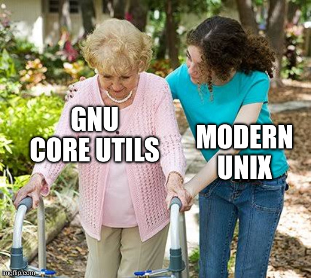
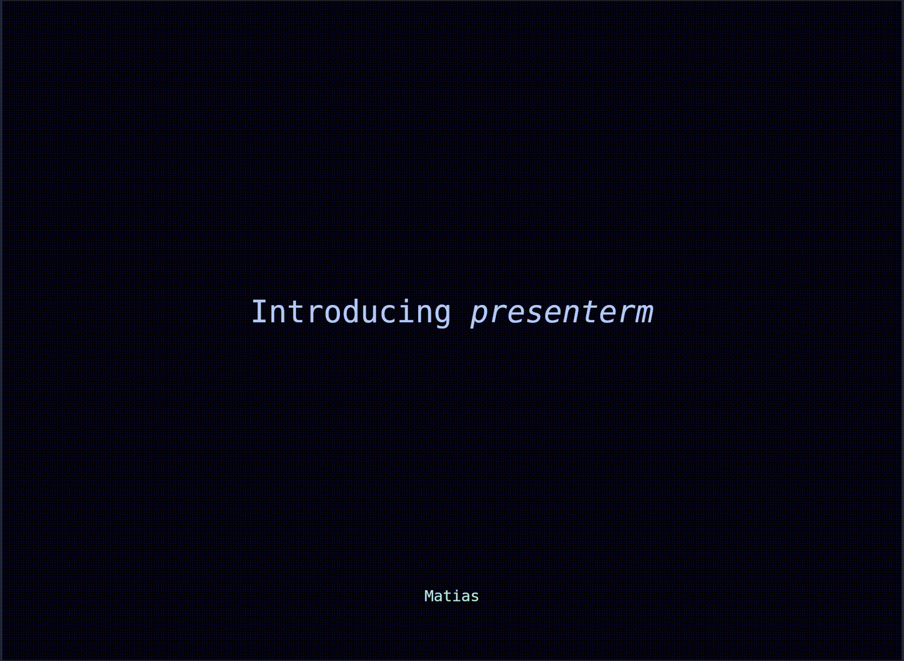

<!-- speaker_note: |

Title:
Join us at the terminal restaurant

Abstract:
I invite you to a full-course meal of clis, tuis, and other delicacies from the terminal.
For starters, we will have a battle between old dishes and their newer alternative.
The main dish is a CLI buffet from many chefs around the world
And for dessert will be an assortiment of configurations picked by the chef.
-->

Test de vision
===


# Bonjour je suis le titre

## Et moi le sous-titre

bla bla bla, I love talking.

Yap for the yap god

^ this is a reference btw

```rust
fn la_super_fonction(value: u64, deus: Arc<Mutex<BufStream>>) {
    todo!()
}
```

<!-- column_layout: [1, 1] -->
<!-- column: 0 -->
```bash +exec_replace +pty:60:2
ls -lah --color=always ./cli-tools.md
```
```bash +exec_replace +pty:70:14
duf -only local
```

Ok but what is a terminal tool?
===

<!-- speeaker_notes: |

Ok so I'll assume every one present knows what a terminal is, right ?
...
Ok so now, when you interact with your terminal, you type some text, offer it to the terminal, and in exchange, you receive some text back.
I'll distinguish two kind of exchange.
1st, Command Line Interfaces, or CLIs for short. these are a one-shot interaction with the terminal.
you start a program, with some input parameter, and await for text results, without interaction with that program.
For example here, `wc`, [hit ctrl-e], I execute it, and have the result of it. In this file, there are 271 lines.

The 2nd kind are Text User Interfaces, TUIs. These are more long-lived programs, where you continue to interact with the terminal, and the program, while it is running. These usually take the full screen of your terminal.
-->


<!-- column_layout: [1, 1] -->
<!-- column: 0 -->
<!-- //  -->

<!-- pause -->
<!-- column: 1 -->

# CLI (Command Line Interface)

```bash +exec
wc -l cli-tools.md
```
<!-- pause -->

# TUI (Text User Interface)


```bash +exec +acquire_terminal
nvim cli-tools.md
```

<!-- end_slide -->
<!-- new_lines: 6 -->
<!-- speeaker_notes: |
Ok, now that we know what we're working with, how will the remainder of this talk go?
This will be a kind of an all-you-can-eat buffet.
I'll show you many programs, you'll like some or hate other.
So just pick whatever you find interesting
-->


Starters: Modern Unix
===


<!-- speeaker_notes: |
We will no begin with the starters.
I'll show you many replacement for usual CLIs.
We're not in the 90s anymore, so we can have more efficient and user-friendly tools right ?!
-->

ls => eza
===

<!-- alignment: center -->

*list files*

<!-- new_lines: 2 -->
<!-- column_layout: [2, 2] -->
<!-- column: 0 -->
```bash
ls -lah .
```
```bash +exec_replace +pty:60:12
ls -lah --color=always .
```
🙁

<!-- pause -->

<!-- column: 1 -->
```bash
eza -lah --icons=always --git-ignore .  
```
```bash +exec_replace +pty:60:12
eza -lah --color=always --icons=always --git-ignore .  
```
😀

- colors
- better ordering
- human readable size (by default)
- icons (optional)
- git integration

<!-- reset_layout -->
https://github.com/eza-community/eza

du => dust
===

<!-- alignment: center -->

*estimate file space usage*

<!-- new_lines: 2 -->
<!-- column_layout: [1, 1] -->
<!-- column: 0 -->
```bash
du -h -a --exclude=".git"                    
```
```bash +exec_replace +pty:40:12
du -h -a --exclude=".git"
```

🙁

<!-- pause -->

<!-- column: 1 -->
```bash
dust -i                                      
```
```bash +exec_replace +pty:51:12
dust -C -P -i -w 50
```
😀

- colors
- ordered by size
- visual help
- show files, by default
- human readable size, by default

<!-- reset_layout -->
https://github.com/bootandy/dust

df => duf
===

<!-- alignment: center -->

*estimate disk usage*

<!-- new_lines: 2 -->
<!-- column_layout: [1, 1] -->
<!-- column: 0 -->
```bash
df -h -T -x tmpfs -x efivarfs -x devtmpfs
```
```bash +exec_replace +pty:60:14
df -h -T -x tmpfs -x efivarfs -x devtmpfs
```

🙁

<!-- pause -->

<!-- column: 1 -->
```bash
duf -only local
```
```bash +exec_replace +pty:70:14
duf -only local
```
😀

- colors
- visual help
- human readable size, by default
- ignore special devices

<!-- reset_layout -->
https://github.com/muesli/duf

cat => bat
===

<!-- alignment: center -->

*Displaying files*

<!-- new_lines: 2 -->
<!-- column_layout: [1, 1] -->
<!-- column: 0 -->
```bash
cat main.rs
```
```bash +exec_replace +pty:40:8
cat attachments/main.rs
```

🙁

<!-- pause -->

<!-- column: 1 -->
```bash
bat main.rs
```
```bash +exec_replace +pty:40:8
bat --theme light attachments/main.rs
```
😀

- colors
- line numbers
- syntax highlighting
- git integration
- automatig paging

<!-- reset_layout -->
https://github.com/sharkdp/bat

<!-- pause -->
```bash +exec +acquire_terminal
bat --theme light flake.nix
```

htop => btop
===

<!-- alignment: center -->

*Monitoring system resources*

<!-- new_lines: 2 -->
<!-- column_layout: [1, 1] -->
<!-- column: 0 -->
```bash +exec +acquire_terminal
htop
```

🙁

<!-- pause -->

<!-- column: 1 -->
```bash +exec +acquire_terminal
btop
```
😀

- colors
- line numbers
- syntax highlighting
- git integration
- show whitespaces
- automatig paging

<!-- reset_layout -->
https://github.com/aristocratos/btop

grep => ripgrep
===

<!-- alignment: center -->

*Search pattern in files*

<!-- new_lines: 2 -->
<!-- column_layout: [1, 1] -->
<!-- column: 0 -->
```bash
grep -R --line-number "Hello" .
```

```bash +exec_replace +pty:60:10
grep -R --line-number "Hello" .
```

🙁

<!-- pause -->

<!-- column: 1 -->
```bash
rg "Hello"
```

```bash +exec_replace +pty:60:10
rg "Hello"
```
😀

- fast
- colors
- line numbers (by default)
- recursive (by default)
- git ignore
- ignore hidden files

<!-- reset_layout -->
https://github.com/BurntSushi/ripgrep

find => fd
===

<!-- alignment: center -->

*find files*

<!-- new_lines: 2 -->
<!-- column_layout: [1, 1] -->
<!-- column: 0 -->
```bash
find -name "*.rs"     # glob
find -regex ".*\.rs"  # regex
```

```bash +exec_replace +pty:60:10
find -name "*.rs"
```

🙁

<!-- pause -->

<!-- column: 1 -->
```bash
fd --glob "*.rs"  # globe
fd ".*\.rs"       # regex
```

```bash +exec_replace +pty:60:10
fd --glob "*.rs"
```
😀

- colors
- git ignore
- ignore hidden files

<!-- reset_layout -->
https://github.com/sharkdp/fd  
(same guy that did `bat` btw)

CTRL-R => atuin
===

<!-- alignment: center -->

*Shell history*

<!-- new_lines: 2 -->
<!-- column_layout: [1, 1] -->
<!-- column: 0 -->
```bash
CTRL-R, then write ping
```

```
(reverse-i-search)`ping': ping google.com
```

🙁

<!-- pause -->

<!-- column: 1 -->
```bash
CTRL-R, then write ping

```

```bash +exec_replace +pty:60:10
atuin search --interactive ping
```
😀

- colors
- fuzzy-finder
- view previous command
- filter by global/session/directory

<!-- reset_layout -->
https://github.com/atuinsh/atuin

diff => delta
===

<!-- alignment: center -->

*Diff viewer*

<!-- new_lines: 2 -->
<!-- column_layout: [1, 1] -->
<!-- column: 0 -->
```bash
git diff before.txt after.txt

```

```bash +exec_replace +pty:60:10
git -c pager.diff=cat diff --no-index attachments/before.txt attachments/after.txt
```

🙁

<!-- pause -->

<!-- column: 1 -->
```bash
git diff before.txt after.txt | delta

```

```bash +exec_replace +pty:60:12
git -c pager.diff=cat diff --no-index attachments/before.txt attachments/after.txt | delta --syntax-theme "GitHub" --light # --plus-style "syntax" --minus-style "syntax" --plus-emph-style "bold syntax" --minus-emph-style "bold syntax"
```
😀

- colors
- side by side
- file name

<!-- reset_layout -->
https://github.com/dandavison/delta

Plat principal: CLI buffet
===

<!-- speaker_note: |

Ok maintenant on va passer au plat principal

# cli
jq
fzf
xan
viu
fastfetch
glow
cht-sh

# tui
wiper
bluetui
presenterm
zellij
herdr

-->


jq
===


<!-- alignment: center -->

*JSON Processor*

https://github.com/jqlang/jq

<!-- new_lines: 2 -->
<!-- column_layout: [1, 1, 1] -->
<!-- column: 0 -->
```bash +exec_replace
# jq -C . attachments/commits.json 
# jq '.[0].commit' attachments/commits.json
echo '{"foo": 42, "bar": [1, 2, 3], "baz": [ {"a": 5}, {"a": 6}, {"a": 7}]}' | jq -C
```

<!-- pause -->

<!-- column: 1 -->
```bash
# query 'bar' value
jq '.bar'
```

```bash +exec_replace
echo '{"foo": 42, "bar": [1, 2, 3]}' | jq -C '.bar'
```

<!-- pause -->

```bash
# query 1st element of  'bar' value
jq '.bar[0]'
```

```bash +exec_replace
echo '{"foo": 42, "bar": [1, 2, 3]}' | jq -C '.bar[0]'
```

<!-- pause -->

<!-- column: 2 -->
```bash
# query 'a' element of 1st 'baz' elements
jq '.baz[0].a'
```

```bash +exec_replace
echo '{"foo": 42, "bar": [1, 2, 3], "baz": [ {"a": 5}, {"a": 6}, {"a": 7}]}' | jq -C '.baz[0].a'
```

<!-- pause -->

```bash
# query 'a' element of all 'baz' elements
jq '.baz[].a'
```

```bash +exec_replace
echo '{"foo": 42, "bar": [1, 2, 3], "baz": [ {"a": 5}, {"a": 6}, {"a": 7}]}' | jq -C '.baz[].a'
```

yq
===


<!-- alignment: center -->

*YAML/TOML Processor*

https://github.com/mikefarah/yq

<!-- new_lines: 2 -->
<!-- column_layout: [2, 2, 4] -->
<!-- column: 0 -->
```toml
[programs]
[programs.activemq]
group = "org.apache.activemq"
artifact = "activemq-all"
versions."6.1.8" = "..."

[programs.arthas]
group = "com.taobao.arthas"
artifact = "arthas-all"
versions."4.1.1" = "..."

[programs.auto]
group = "com.google.auto"
artifact = "auto"
versions."1.11.1" = "..."
```

<!-- pause -->

<!-- column: 1 -->
```bash
yq '.programs["arthas"]' programs.toml
```

```bash +exec_replace
yq -C '.programs["arthas"]' attachments/programs.toml
```
<!-- pause -->
```bash
yq '.programs["arthas"].artifact' programs.toml
```

```bash +exec_replace
yq -C '.programs["arthas"].artifact' attachments/programs.toml
```
<!-- column: 2 -->


<!-- pause -->

```bash
yq -p toml -o csv '["program", "group", "artifact", "version"], (.programs | keys[] as $n | .[$n] as $p | $p.group as $g | $p.artifact as $a | ($p.versions | keys | .[]) as $v | [$n, $g, $a, $v])' programs.toml
```

```bash +exec_replace +pty:63:12
yq -p toml -o csv '["program", "group", "artifact", "version"], (.programs | keys[] as $n | .[$n] as $p | $p.group as $g | $p.artifact as $a | ($p.versions | keys | .[]) as $v | [$n, $g, $a, $v])' attachments/programs.toml
```

yq
===
<!-- alignment: center -->
*YAML/TOML Processor*

https://github.com/mikefarah/yq
<!-- new_lines: 2 -->
<!-- column_layout: [2, 2, 4] -->
<!-- column: 0 -->
```toml
[programs]
[programs.activemq]
group = "org.apache.activemq"
artifact = "activemq-all"
versions."6.1.8" = "..."

[programs.arthas]
group = "com.taobao.arthas"
artifact = "arthas-all"
versions."4.1.1" = "..."

[programs.auto]
group = "com.google.auto"
artifact = "auto"
versions."1.11.1" = "..."
```
<!-- column: 1 -->
```bash
yq '.programs["arthas"]' programs.toml
```
```bash +exec_replace
yq -C '.programs["arthas"]' attachments/programs.toml
```
```bash
yq '.programs["arthas"].artifact' programs.toml
```
```bash +exec_replace
yq -C '.programs["arthas"].artifact' attachments/programs.toml
```
<!-- column: 2 -->

```bash
yq -p toml -o csv '["program", "group", "artifact", "version"], (.programs | keys[] as $n | .[$n] as $p | $p.group as $g | $p.artifact as $a | ($p.versions | keys | .[]) as $v | [$n, $g, $a, $v])' programs.toml
```

```bash +exec_replace +pty:63:12
yq -p toml -o csv '["program", "group", "artifact", "version"], (.programs | keys[] as $n | .[$n] as $p | $p.group as $g | $p.artifact as $a | ($p.versions | keys | .[]) as $v | [$n, $g, $a, $v])' attachments/programs.toml | xan view -AeM
```

xan
===

<!-- speaker_note: imagine SQL queries, but for CSVs-->

<!-- alignment: center -->

*the CSV magician*

https://github.com/medialab/xan  
🐓
<!-- column_layout: [1, 2] -->

<!-- column: 0 -->

```bash +exec_replace
head attachments/data.csv #| bat -l csv --color always --style snip
echo "..."
# xan head  attachments/data.csv| xan view -AMe --color always
```

<!-- column: 1 -->
<!-- pause -->
<!-- speaker_note: |
xan view -M
-->
```bash
xan filter 'State eq "OK"' attachments/data.csv |\
xan map "(LoadTimeMS + ScanTimeMS) as Time"| \
xan groupby Program "mean(Time) as Time, first(Invocations) as Invocations" |\
xan sort -s Time -N |\
xan transform Time '(Time / 1000).to_fixed(2)' |\
xan view
```
```bash +exec_replace +pty:80:20
xan filter 'State eq "OK"' attachments/data.csv |\
xan map "(LoadTimeMS + ScanTimeMS) as Time"| \
xan groupby Program "mean(Time) as Time, first(Invocations) as Invocations" |\
xan sort -s Time -N |\
xan transform Time '(Time / 1000).to_fixed(2)' |\
xan view -AM
```

fzf
===

<!-- alignment: center -->

*fuzzy-finder*

https://github.com/junegunn/fzf

```bash
fzf
```
```bash +exec_replace +pty:100:25
fzf
```

fzf
===

<!-- alignment: center -->

*fuzzy-finder*

https://github.com/junegunn/fzf

```bash
fzf --preview "bat --color always {}"
```
```bash +exec_replace +pty:100:25
fzf --preview "bat --color always {}"
```
```bash +exec +acquire_terminal
fzf --preview "bat --color always {}" --color=light
```

viu
===

<!-- alignment: center -->

*view images*

https://github.com/atanunq/viu

```bash +exec
viu attachments/buffet.jpg
```

fastfetch
===

<!-- alignment: center -->

*system information*

https://github.com/atanunq/viu

```bash
fastfetch
```

```bash +exec_replace +pty:120:29
fastfetch
```

glow
===

<!-- alignment: center -->

*render markdown*

https://github.com/charmbracelet/glow

<!-- column_layout: [1, 1] -->

<!-- column: 0 -->

```markdown
# header

normal text

1. item 1
2. item 2

- bullet
- bulllet

> I must not fear. Fear is the mind-killer. Fear is the little-death that brings total obliteration

*italic*

**bold**

- [ ] task ?
- [x] task !
```

<!-- column: 1 -->

```bash +exec_replace +pty:70:25
echo -e "# header\nnormal text\n1. item 1\n2. item 2\n- bullet\nbulllet\n> One must imagine Sisyphus building softwares.\n\n*italic*\n**bold**\n- [ ] task ? \n- [x] task ! \n" | glow -w 70
```

mdfried
===

<!-- alignment: center -->

*render markdown*

https://github.com/benjajaja/mdfried

<!-- column_layout: [1, 1] -->

<!-- column: 0 -->

```markdown
# header

normal text

1. item 1
2. item 2

- bullet
- bulllet

> I must not fear. Fear is the mind-killer. Fear is the little-death that brings total obliteration

*italic*

**bold**

- [ ] task ?
- [x] task !
```

<!-- column: 1 -->

```bash +exec_replace +pty:70:25
echo -e "# header\nnormal text\n1. item 1\n2. item 2\n- bullet\nbulllet\n> One must imagine Sisyphus building softwares.\n\n*italic*\n**bold**\n- [ ] task ? \n- [x] task ! \n" | mdfried
```

just
===

<!-- alignment: center -->
*just a command runner*

https://github.com/casey/just

<!-- column_layout: [1, 1] -->
<!-- column: 0 -->
```make
alias b := build
host := `uname -a`

# build main
build:
    cc *.c -o main

# test everything
test-all: build
    ./test --all

# run a specific test
test TEST: build
    ./test --test {{TEST}}
```

<!-- column: 1 -->
```bash
just -l
```
```bash +exec_replace
just --justfile attachments/justfile -l --color always
```


cht.sh
===
<!-- alignment: center -->
*terminal cheat sheets*

https://github.com/chubin/cheat.sh
<!-- column_layout: [1, 1] -->
<!-- column: 0 -->
```bash
cht.sh curl
```
```bash +exec_replace +pty:70:20
cht.sh curl
```
<!-- pause -->
<!-- column: 1 -->
```bash
cht.sh tar~list
```
```bash +exec_replace +pty:70:20
cht.sh tar~list
```

cht.sh
===
<!-- alignment: center -->
*terminal cheat sheets*

https://github.com/chubin/cheat.sh
<!-- column_layout: [1, 1] -->
<!-- column: 0 -->
```bash
curl cht.sh/curl
```
```bash +exec_replace +pty:70:20
curl cht.sh/curl
```
<!-- column: 1 -->
```bash
curl cht.sh/tar~list
```
```bash +exec_replace +pty:70:20
curl cht.sh/tar~list
```


wiper
===
<!-- alignment: center -->
*disk cleanup tool*

https://github.com/ikebastuz/wiper

```bash +exec_replace +pty:100:30
wiper
```

bluetui
===
<!-- alignment: center -->
*bluetooth device manager*

https://github.com/pythops/bluetui

```bash +exec_replace +pty:100:30
bluetui
```

presenterm
===
<!-- alignment: center -->
*presentation in the terminal*

https://github.com/mfontanini/presenterm

<!-- // ```bash +exec_replace -->
<!-- // presenterm cli-tools.md -->
<!-- // ``` -->


zellij
===
<!-- alignment: center -->
*terminal multiplexer*

https://github.com/zellij-org/zellij

```bash +acquire_terminal
zellij
```

Dessert: Configuration is all you need
===


aliases
===

```shell
myip="ip route | head -n 1 | cut --delimiter=\" \" -f9"

..="cd .."
...="cd ../.."
....="cd ../../.."

```

functions
===

```shell
mann() {
  man "${1}" | bat -l man --style changes,snip
}

ns() {
  nix shell nixpkgs#${1}
}

json() {
  cat $1 | jq
}
```

git config
===

```toml
[alias]
    aliases = "config get --all --show-names --regex '^alias.'"
    amend = "commit --amend"
    cam = "commit -a -m"
    cm = "commit -m"
    glog = "log --all --graph --online --branches='*' --tags='*'"
    glog2 = "log --all --graph --date=format:'%d-%m-%y' --format='%C(auto)%h %d %ad %s' --branches='*' --tags='*'"
[rerere]
    enabled = true
[includeIf "gitdir:~/these/"]
    path = "~/these/.gitconfig"
[includeIf "gitdir:~/enseignement/"]
    path = "~/these/.gitconfig"
```


Sources
===
<!-- alignment: center -->

[johnalanwoods/maintained-modern-unix](https://github.com/johnalanwoods/maintained-modern-unix)

[Terminal Trove](https://terminaltrove.com/)

[800 Rust terminal projects](https://blog.orhun.dev/800-rust-projects/)

[Terminal Collective](https://terminalcollective.org/)

